# Terraform AWS Infrastructure

Personal project: provisioning a secure AWS environment with Terraform (Infrastructure as Code) in `ap-south-1` (Mumbai).

## What it builds

- VPC (`10.0.0.0/16`) with a public subnet, Internet Gateway and route table
- Security Group allowing only HTTP (port 80)
- IAM role + instance profile for AWS Systems Manager (no SSH port open, no key pairs)
- EC2 instance (t3.micro, Amazon Linux 2023, encrypted gp3 volume, IMDSv2 enforced) running nginx via user data
- S3 bucket with public access blocked, versioning and AES256 encryption

## Architecture

```
Internet
   |
Internet Gateway
   |
Public Subnet (10.0.1.0/24)
   |
EC2 (nginx) + Security Group (port 80 only)
   |
IAM Role (SSM access)

S3 bucket (private, versioned, encrypted)
```

## Tools

Terraform 1.16, AWS provider 6.x, AWS CLI, Amazon Linux 2023, nginx

## Project structure

```
provider.tf   - AWS provider, region, default tags
network.tf    - VPC, subnet, IGW, route table
security.tf   - security group, IAM role, instance profile
ec2.tf        - EC2 instance and output
s3.tf         - S3 bucket with security settings
```

## How to run

```
terraform init
terraform plan
terraform apply
terraform destroy   # clean up to avoid charges
```

## Screenshots

| Step | Screenshot |
|------|-----------|
| Terraform apply (network) | 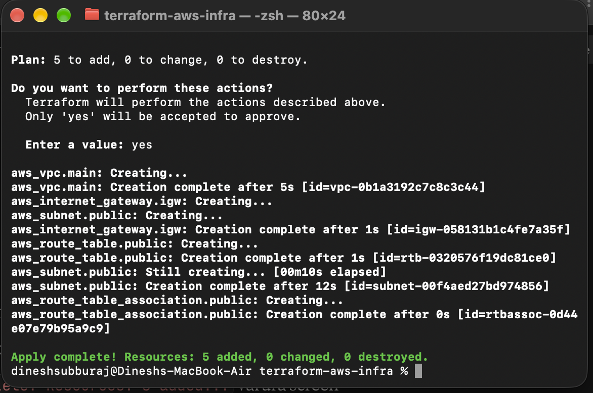 |
| VPC resource map | 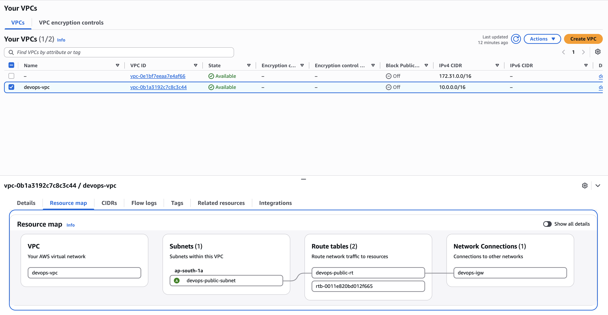 |
| Tags applied by Terraform | 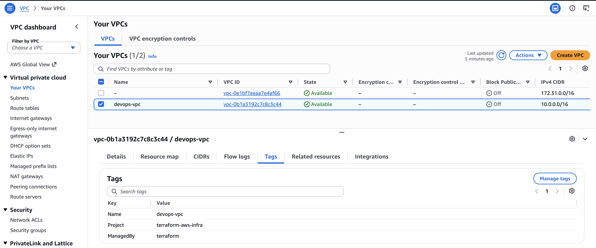 |
| Route table | 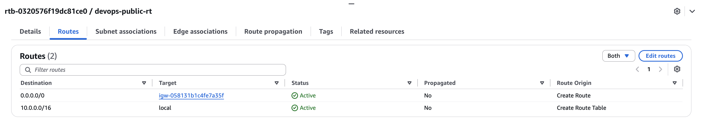 |
| Web server response | 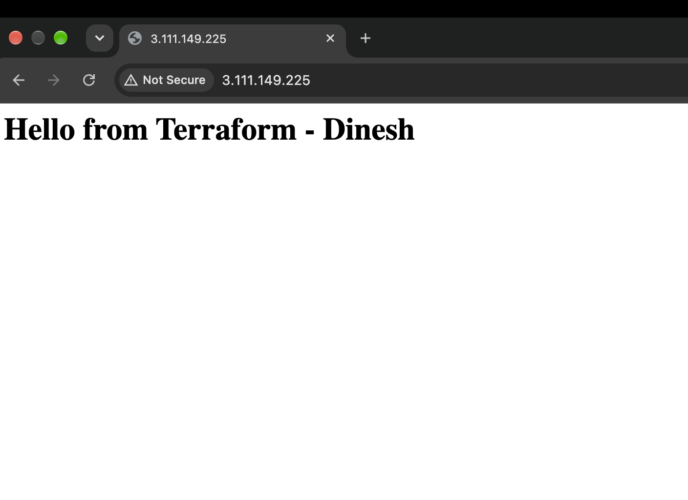 |
| curl test | 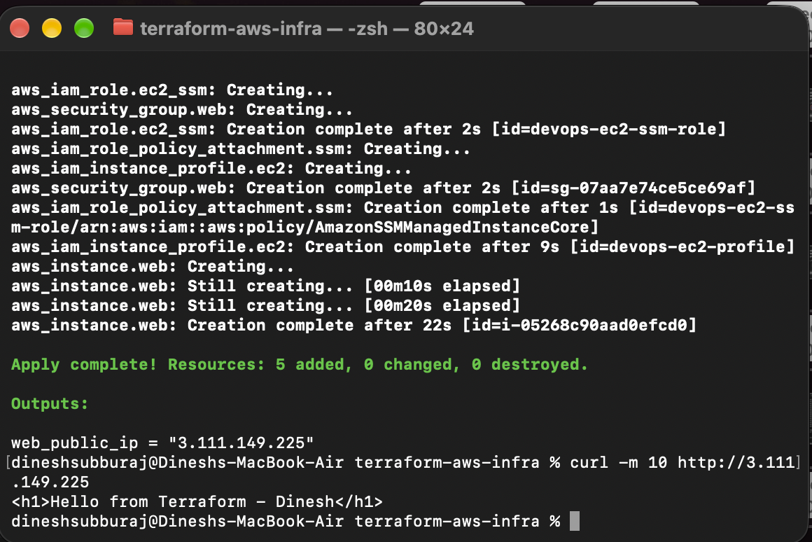 |
| EC2 running | 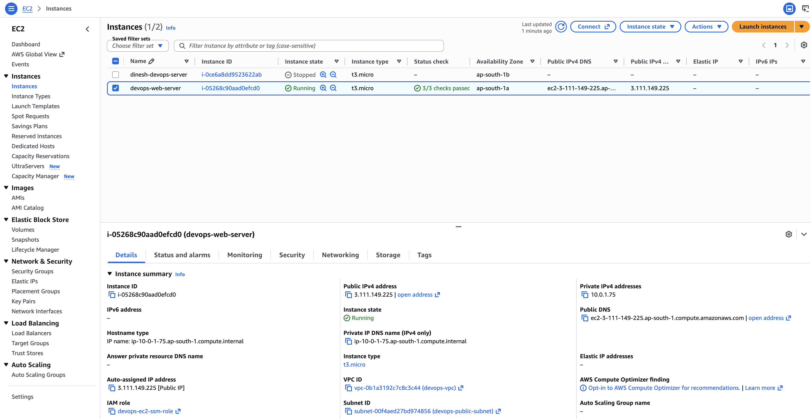 |
| Security group (port 80 only) | 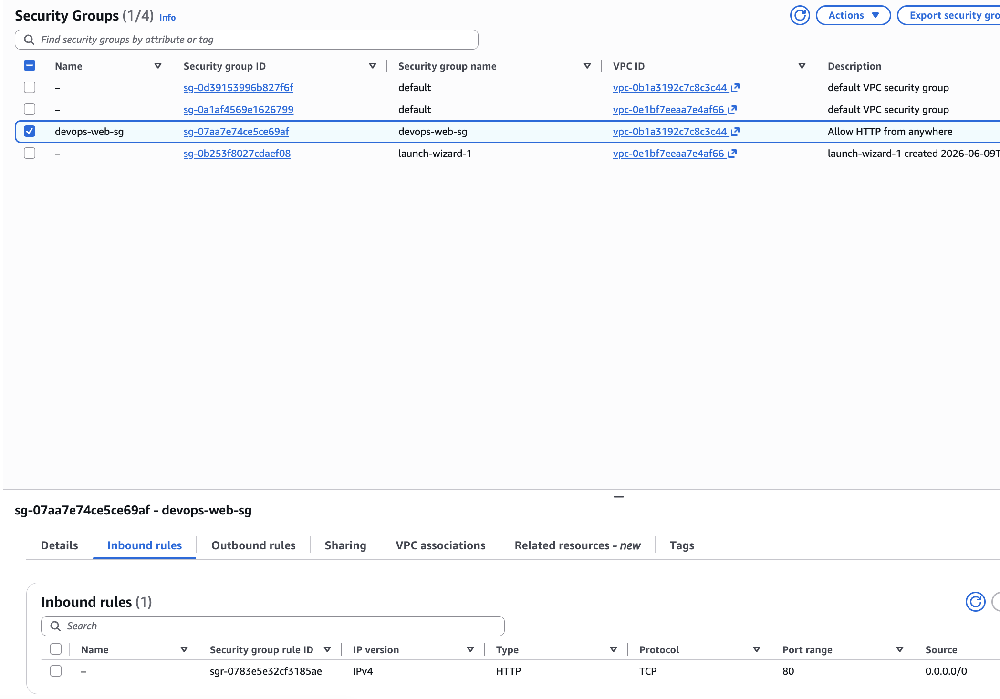 |
| S3 bucket | 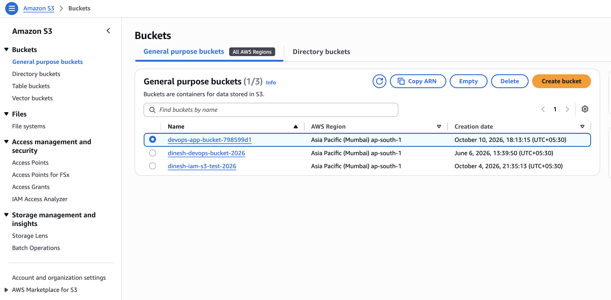 |
| S3 public access blocked | 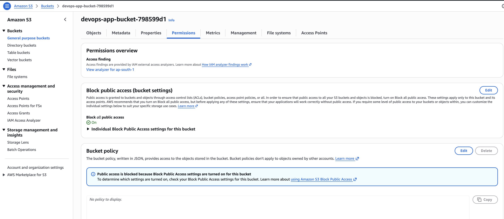 |
| Full apply | 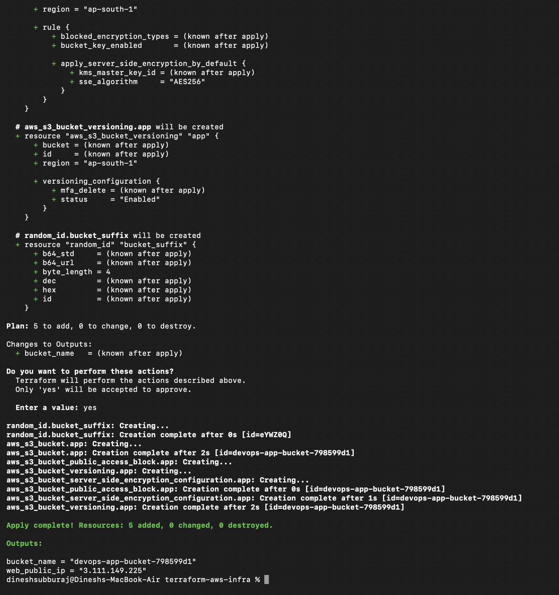 |

## Challenges and fixes

- Browser showed ERR_CONNECTION_TIMED_OUT while the server was healthy. curl confirmed nginx was serving; Chrome had tried HTTPS (port 443), which the security group does not allow. Using http:// fixed it.
- Terraform was outdated (1.5.7) and was upgraded via the HashiCorp Homebrew tap.
- S3 bucket names are globally unique, so a `random_id` suffix is used.

## Security notes

- No SSH port; access via SSM Session Manager
- IMDSv2 required, encrypted root volume
- S3 public access fully blocked
- State files and credentials excluded through `.gitignore`

## What I learned

Writing AWS networking and IAM as code, reading `terraform plan` output, and managing cost by destroying resources after testing.

## Next steps

CI/CD with GitHub Actions and Docker, then Kubernetes with Prometheus and Grafana.
